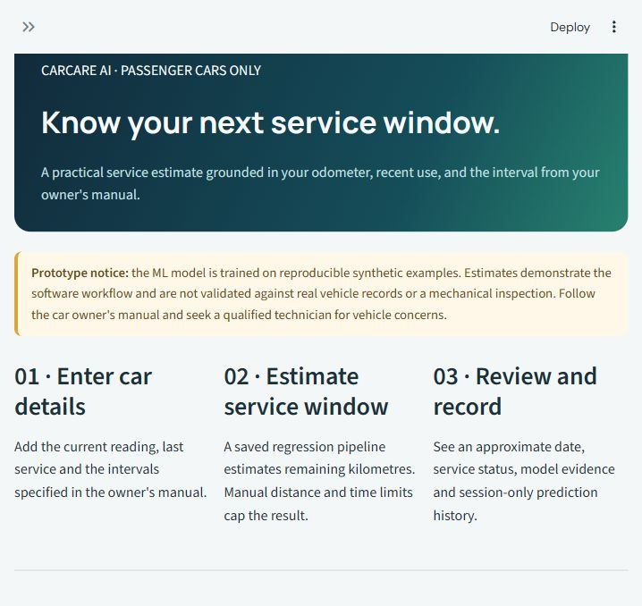
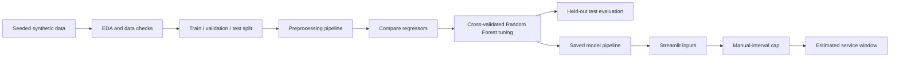

<p align="center">
  
</p>
<p align="center">
  
</p>
<p align="center">
  <a href="https://github.com/shivubuilds-mikasa/ML"></a>
  
  
  
</p>
<p align="center"><b>Estimate a car's remaining distance to its next scheduled service—and see how the model was built.</b></p>

> **Classroom prototype:** The model learns from generated sample data. Its scores do not describe real-world vehicle accuracy, and the app is not a fault-diagnosis tool. Follow the vehicle owner's manual and consult a qualified technician.

## The idea

CarCare AI turns vehicle-use details into an estimated **remaining distance to the next scheduled service**. It demonstrates a complete beginner-friendly ML workflow: generate repeatable data, explore it, prepare features, compare regressors, tune a model, evaluate errors, and connect the saved model to a Streamlit interface.

The app asks for odometer and service-history information plus distance and time limits from the owner's manual. It shows an estimated service window and due status, then caps the estimate to those manual limits.

<p align="center">
  
  <br /><sub>Local Streamlit prototype · no public hosted demo is configured</sub>
</p>

## At a glance

| | |
|---|---|
| **Task** | Regression: estimate remaining kilometres to scheduled service |
| **Data** | 8,000 reproducible synthetic passenger-car records · seed 42 |
| **Selected model** | Tuned Random Forest Regressor |
| **Held-out test set** | 1,600 simulated examples |
| **Test MAE** | 283.05 km |
| **Test RMSE** | 477.82 km |
| **Test R²** | 0.9742 |
| **Interface** | Streamlit · history is stored in session memory only |

## How the workflow fits together



## Inputs and prediction

The output is **`remaining_km_to_service`**. Inputs include:

| Feature | What it represents |
|---|---|
| `current_odometer_km` | Current odometer reading |
| `last_service_odometer_km` | Odometer at the previous service |
| `km_since_last_service` | Distance travelled since that service |
| `vehicle_age_years` | Vehicle age in years |
| `average_daily_km` | Estimated average kilometres driven per day |
| `months_since_last_service` | Elapsed months since service |
| `recommended_interval_km` | Distance interval from the owner's manual |
| `recommended_interval_months` | Time interval from the owner's manual |
| `driving_condition` | City, mixed, or highway use |
| `previous_service_type` | Category recorded for the previous service |

Usage-based features are derived from the service history. Brand and model labels in the app are descriptive and are not model inputs.

## Dataset: where it comes from

The CSV is **generated by this project** with NumPy and a fixed random seed. It is not downloaded from a real customer, workshop, or manufacturer database. Its 8,000 rows use documented educational assumptions for mileage, service intervals, age, driving conditions, and bounded noise.

- Dataset: [`dataset/vehicle_service_data.csv`](dataset/vehicle_service_data.csv)
- Generator: [`src/dataset.py`](src/dataset.py)
- Data review and references: [`docs/DATASET_REVIEW.md`](docs/DATASET_REVIEW.md)

Generated intervals are sample assumptions, not service recommendations. For an actual car, use the intervals in its owner's manual.

## Training and results

We split the data into **64% training, 16% validation, and 20% test** sets. Preprocessing is kept inside scikit-learn pipelines: numeric values use median imputation, categories use most-frequent imputation and one-hot encoding. A median baseline, Decision Tree, Extra Trees, and Random Forest were compared. Random Forest tuning used **3-fold cross-validation**, **8 sampled configurations**, and **MAE** as the selection objective. Validation data guided model selection; the test set was held back for final evaluation.

| Model | MAE (km) | RMSE (km) | R² |
|---|---:|---:|---:|
| Median baseline | 2,503.79 | 3,007.95 | -0.0222 |
| Decision Tree | 397.22 | 679.25 | 0.9479 |
| Extra Trees | 334.35 | 548.59 | 0.9660 |
| Random Forest | 293.44 | 492.98 | 0.9725 |
| **Tuned Random Forest · selected** | **283.05** | **477.82** | **0.9742** |

**How to read the scores:** MAE is the average absolute prediction error in kilometres. RMSE also measures error, but gives larger misses more weight. R² describes how closely the predictions follow patterns in the test targets. Since the targets and test examples are simulated by the same generator, these scores demonstrate learning on the simulation—not accuracy on real cars.

## Run it locally

Python **3.10 or newer** is recommended.

```powershell
python -m venv .venv
.\.venv\Scripts\Activate.ps1
python -m pip install -r requirements.txt
streamlit run app.py
```

Open the local URL printed in the terminal, usually `http://localhost:8501`. The trained model and generated data are included. To regenerate the dataset, model, metrics, and analysis artifacts with the fixed seed, run:

```powershell
python -m src.train
```

On macOS/Linux, activate the environment with `source .venv/bin/activate`.

## What you can explore

- Validated vehicle and previous-service inputs
- Remaining-distance estimate, approximate date, and due status
- Dashboard and saved evaluation metrics
- Dataset and model analysis views
- Session-only service history; it clears when the session resets
- EDA charts, model comparison, residual diagnostics, and system diagram in [`reports/eda/`](reports/eda/)

## Repository map

```text
.
├── app.py
├── config.py
├── dataset/          # Generated CSV and data notes
├── docs/             # Dataset review and references
├── models/           # Saved pipeline, metrics, residuals
├── notebooks/        # Exploratory analysis notebook
├── report/           # Mini-project report (DOCX and PDF)
├── reports/eda/      # Charts, diagnostics, app capture
├── src/              # Data, preprocessing, training, evaluation, prediction
├── tests/            # Project checks
├── TEAM_CONTRIBUTIONS.md
├── VIVA_AND_PRESENTATION.md
└── requirements.txt
```

## Limitations and responsible use

- Data and labels are synthetic; no validation on real vehicles has been performed.
- The model estimates a service interval. It cannot identify failures, inspect a car, or make repair decisions.
- The high R² mainly shows that the workflow learned patterns built into the data generator.
- No account system, database, hosted service, or persistent service-history storage is configured.
- A real system would require consented, licensed service records and validation across vehicle types and time periods, alongside mechanic and manufacturer guidance.

## Project files

- [Mini-project report (DOCX)](report/CarCare_AI_Mini_Project_Report.docx)
- [Mini-project report (PDF)](report/CarCare_AI_Mini_Project_Report.pdf)
- [Team contribution plan](TEAM_CONTRIBUTIONS.md)
- [Viva and presentation notes](VIVA_AND_PRESENTATION.md)

---
<p align="center"><sub>Built as a machine-learning mini project · Synthetic data · Transparent metrics · Practical limits</sub></p>
<p align="center"></p>
